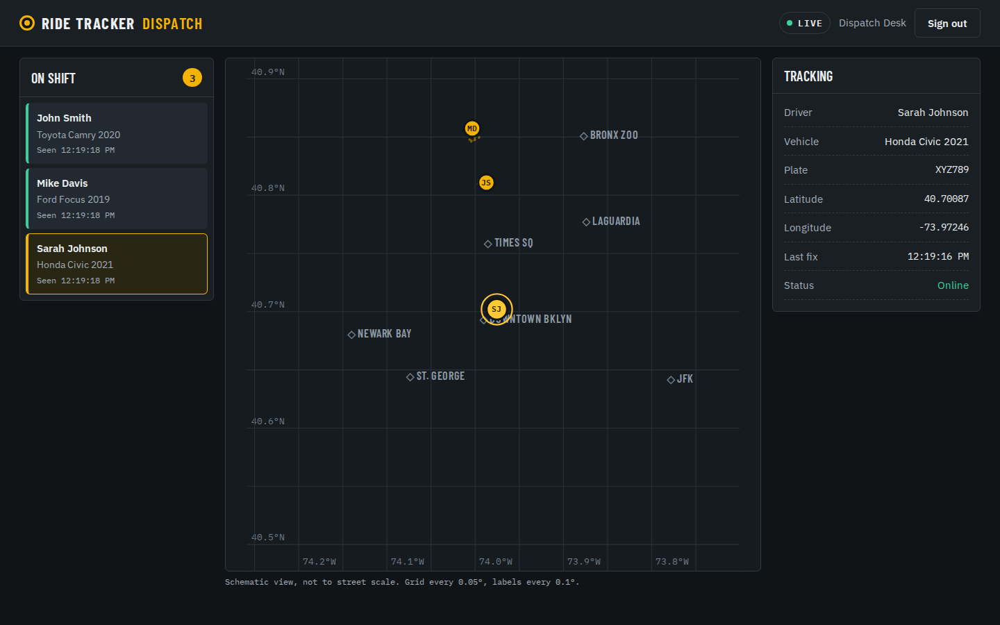
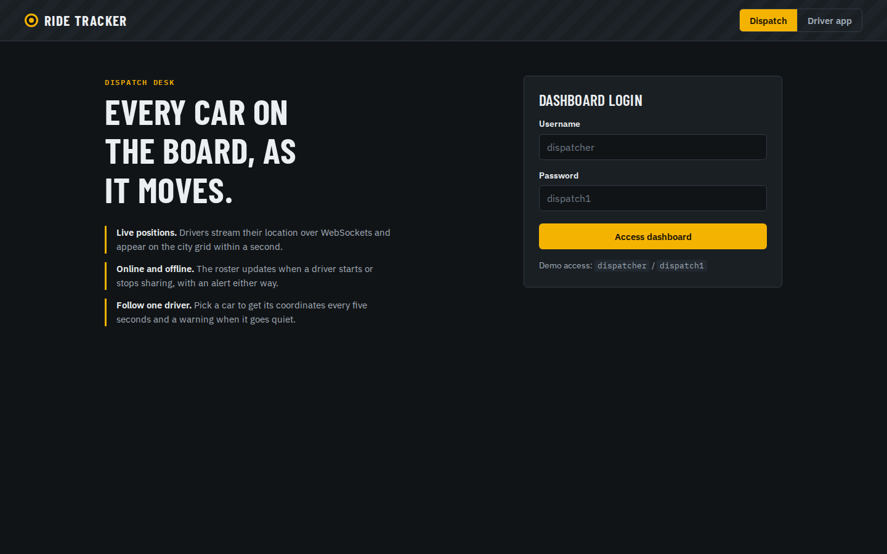
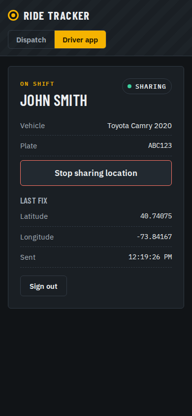
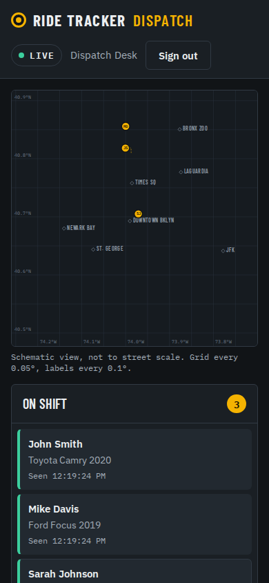
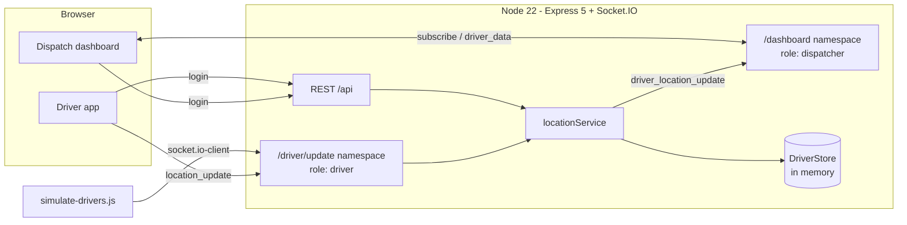

# Ride Tracker

A real-time driver tracking system: drivers stream their position over WebSockets, and a dispatch dashboard shows every online car on a city map and can follow one driver at a time. The backend is Node.js with Express and Socket.IO; the frontend is React, built with Vite.

It is a compact, working example of a few problems every live-location product has to solve: authenticating long-lived socket connections, keeping drivers from speaking for each other, limiting how much a client can send, and keeping in-memory state bounded.



## What it does

- **Driver app.** A driver signs in and starts sharing. The browser sends a position every 10 seconds over the `/driver/update` Socket.IO namespace. The demo has no GPS, so the position drifts around New York.
- **Dispatch dashboard.** A dispatcher signs in and sees the roster of online drivers and a schematic map of the service area, with each car's recent trail. Picking a driver (on the roster or the map) subscribes to them: their details refresh every 5 seconds, and the dashboard warns when they go quiet or disconnect.
- **REST API.** The same login, location update and lookups are available over HTTP.
- **Simulator.** `npm run simulate` (or the `demo` Compose profile) drives the three demo drivers around the city, so the dashboard has something to show.

| Sign-in | Driver app (390 px) | Dashboard on a phone |
| --- | --- | --- |
|  |  |  |

The map is drawn locally in SVG: a latitude/longitude grid over the NYC bounding box and a few landmarks. No map tiles or third-party map APIs are used.

## Architecture



- `src/app.js` builds the Express app, HTTP server and Socket.IO server and returns them with a `close()`. `src/server.js` only listens and handles signals. Tests start the real server on a random port.
- REST and WebSocket updates both go through `src/services/locationService.js`, so they validate, store and broadcast in the same way.
- `DriverStore` keeps sessions, the latest position per driver and the open sockets per driver. Its sweep timer is unref'd, and the session table is capped.
- In the container the backend also serves the built UI, so pages, API and sockets share one origin and Helmet's content security policy can stay strict.

## Quick start (Docker Compose)

Requires Docker with Compose v2.

```bash
cp .env.example .env
# set JWT_SECRET in .env, for example to the output of: openssl rand -hex 32
docker compose --profile demo up --build
```

Open http://localhost:3001 and sign in as `dispatcher` / `dispatch1`. With the `demo` profile, three simulated drivers appear within a few seconds. Leave out `--profile demo` to run only the app, then sign in on the **Driver app** tab yourself.

The image is a three-stage build (Vite build, production dependencies, runtime) on `node:22-bookworm-slim`. It runs as the unprivileged `node` user, and Compose adds a read-only filesystem, drops all capabilities and sets `no-new-privileges`. Compose refuses to start without `JWT_SECRET`.

Stop with `docker compose --profile demo down`.

## Local development

Requires Node 22 (see `.nvmrc`).

```bash
npm install
npm run dev                  # API on :3001, restarts on change (node --watch)

cd frontend
npm install
npm run dev                  # UI on http://localhost:5173, proxies /api and /socket.io to :3001

npm run simulate             # optional, from the project root: three moving demo drivers
```

`npm start` and `npm run dev` load `.env` if it exists; variables already set in the shell take precedence. Outside production, an empty `JWT_SECRET` means a random secret per process, so tokens stop working when the server restarts.

### Demo accounts

| Role | Username | Password |
| --- | --- | --- |
| Dispatcher | `dispatcher` | `dispatch1` |
| Driver | `driver1`, `driver2`, `driver3` | `password1`, `password2`, `password3` |

These are hard-coded demo accounts in `src/utils/auth.js`; there is no user database.

## Configuration

| Variable | Default | Meaning |
| --- | --- | --- |
| `JWT_SECRET` | random per process outside production | HMAC key for tokens. **Required** when `NODE_ENV=production`; the server refuses to start without it. |
| `PORT` | `3001` | HTTP port (in Compose, the host port). |
| `NODE_ENV` | `development` | `production` in the Docker image. |
| `CORS_ORIGINS` | Vite ports outside production, none in production | Extra browser origins, comma-separated. The page's own origin is always allowed. |
| `LOGIN_RATE_LIMIT` | `10` | Failed logins per client IP and username per 15 minutes. |
| `LOCATION_RATE_LIMIT` | `60` | Location updates per minute, per driver over REST and per connection over WebSocket. |
| `STATIC_DIR` | `frontend/dist` | Built UI to serve, if present. |

## API

Tokens are JWTs (HS256) valid for five minutes, sent as `Authorization: Bearer <token>` or as `auth.token` in the Socket.IO handshake. Each token carries a role (`driver` or `dispatcher`) and an id that logout revokes.

| Method and path | Who | Purpose |
| --- | --- | --- |
| `POST /api/login` | anyone | Exchange demo credentials for a token |
| `POST /api/logout` | signed in | Revoke the token and close sockets opened with it |
| `GET /api/profile` | signed in | Own profile (drivers also get their last position) |
| `POST /api/driver/update` | driver | Publish own position `{ lat, lng }` |
| `GET /api/driver/:driverId/location` | dispatcher, or that driver | One driver's last position |
| `GET /api/driver/online` | dispatcher | Online drivers with positions |
| `GET /api/driver/stats` | dispatcher | Store counters |
| `GET /api` | anyone | Endpoint index |
| `GET /health` | anyone | Liveness |

These examples were captured from the Compose stack (tokens shortened):

```http
POST /api/login
{"username": "driver2", "password": "password2"}

200 OK
{
  "success": true,
  "token": "eyJhbGciOiJIUzI1NiIs...",
  "profile": { "id": "driver2", "name": "Sarah Johnson", "vehicle": "Honda Civic 2021",
               "license": "XYZ789", "rating": 4.9, "role": "driver" },
  "expiresIn": "5m",
  "expiresAt": "2026-11-10T12:24:26.000Z"
}
```

```http
POST /api/driver/update            (driver token)
{"lat": 40.7411, "lng": -73.9897}

200 OK
{ "success": true, "message": "Location updated successfully",
  "location": { "lat": 40.7411, "lng": -73.9897 }, "timestamp": "2026-11-10T12:19:26.986Z" }
```

```http
POST /api/driver/update            (driver token)
{"lat": 123, "lng": -73.9}

400 Bad Request
{ "error": "Invalid coordinates: lat must be -90 to 90, lng must be -180 to 180" }
```

```http
GET /api/driver/driver1/location   (driver2's token)

403 Forbidden
{ "error": "Drivers can only read their own location" }
```

```http
GET /api/driver/online             (dispatcher token; trimmed to one of three drivers)

200 OK
{
  "success": true,
  "drivers": [
    { "driverId": "driver2",
      "profile": { "id": "driver2", "name": "Sarah Johnson", "vehicle": "Honda Civic 2021", "license": "XYZ789", "rating": 4.9 },
      "location": { "lat": 40.7411, "lng": -73.9897 },
      "lastSeen": "2026-11-10T12:19:26.986Z", "isOnline": true }
  ],
  "count": 1,
  "timestamp": "2026-11-10T12:19:27.009Z"
}
```

Without a token, tracking reads answer `401 {"error": "Access token required"}`.

### WebSocket events

**`/driver/update`** (driver token required)

| Direction | Event | Payload |
| --- | --- | --- |
| client to server | `location_update` | `{ lat, lng }` |
| server to client | `connected`, `location_updated` | confirmation with timestamp |
| server to client | `error` | `{ message }`: invalid payload, rate limit, or ended session (the socket is then closed) |

**`/dashboard`** (dispatcher token required)

| Direction | Event | Payload |
| --- | --- | --- |
| client to server | `subscribe` / `unsubscribe` | `{ driverId }` / none |
| client to server | `get_online_drivers`, `get_driver_info` | none / `{ driverId }` |
| server to client | `online_drivers` | roster with positions, sent on connect and on changes |
| server to client | `driver_location_update` | every accepted position, from any driver |
| server to client | `driver_data` | the followed driver, every 5 seconds while online |
| server to client | `driver_offline`, `OFFLINE_DRIVER` | the followed driver is offline (on subscribe / every 60 seconds) |
| server to client | `driver_connected`, `driver_disconnected` | roster changes |

## Design notes

- **Identity comes from the token.** A driver's id is never read from the request body or the socket payload, so a driver can only move their own car. Drivers can read only their own location; tracking everyone is a dispatcher capability. The original version left the dashboard namespace and the read endpoints open to anyone.
- **Sockets are re-checked.** The handshake verifies the JWT, its role and that it has not been revoked. Each later `location_update` re-checks the session, and logout disconnects every socket opened with that token.
- **Limits.** JSON bodies and Socket.IO messages are capped at 10 kB. Failed logins are rate-limited per client and username, so one guessed account does not lock out everyone behind the same NAT. Location updates are rate-limited per driver (REST) and per connection (WebSocket).
- **Bounded memory.** Positions exist only for the known drivers; sessions are swept at expiry and capped at 10,000 (oldest evicted); a driver connected from two tabs stays online until the last connection closes.
- **CORS.** Allowed origins come from `CORS_ORIGINS`. Socket.IO's own CORS option covers only long-polling, so an `allowRequest` hook also refuses WebSocket upgrades from other origins.
- **Single process by design.** State lives in memory, so the server does not scale horizontally as is. Running several instances would need a shared store (for example Redis) and the Socket.IO Redis adapter.

## Tests

```bash
npm test                     # backend: node:test + supertest + socket.io-client against a real server
npm run lint
cd frontend && npm test      # frontend: Vitest + Testing Library (jsdom)
cd frontend && npm run lint
```

The backend suite (47 tests) covers login, roles, token revocation, forged and unsigned tokens, payload validation, rate limits, CORS for HTTP and WebSocket, store bounds and static serving. The frontend suite (10 tests) covers the sign-in role checks and the dashboard's socket handling with a fake socket.

## Project layout

```
src/
  app.js                 Express + Socket.IO factory
  server.js              entry point
  config/                environment config, service-area bounds
  controllers/ routes/   REST handlers
  services/              shared location update path
  models/driverStore.js  in-memory sessions, positions, sockets
  utils/                 auth/roles, validation, CORS policy, rate window, logger
  ws/                    /driver/update and /dashboard namespaces
scripts/simulate-drivers.js
test/                    backend tests
frontend/                Vite + React 19 app
```

## License

MIT. See [LICENSE](LICENSE).
